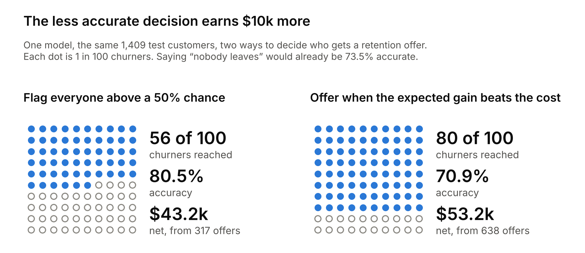
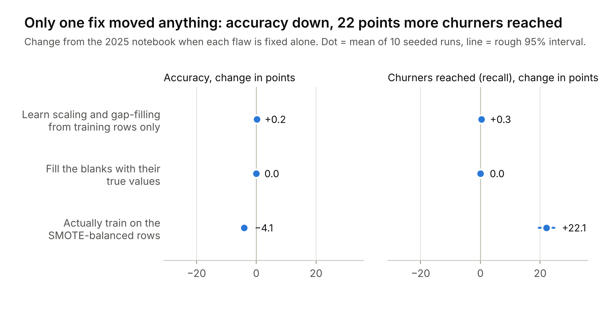
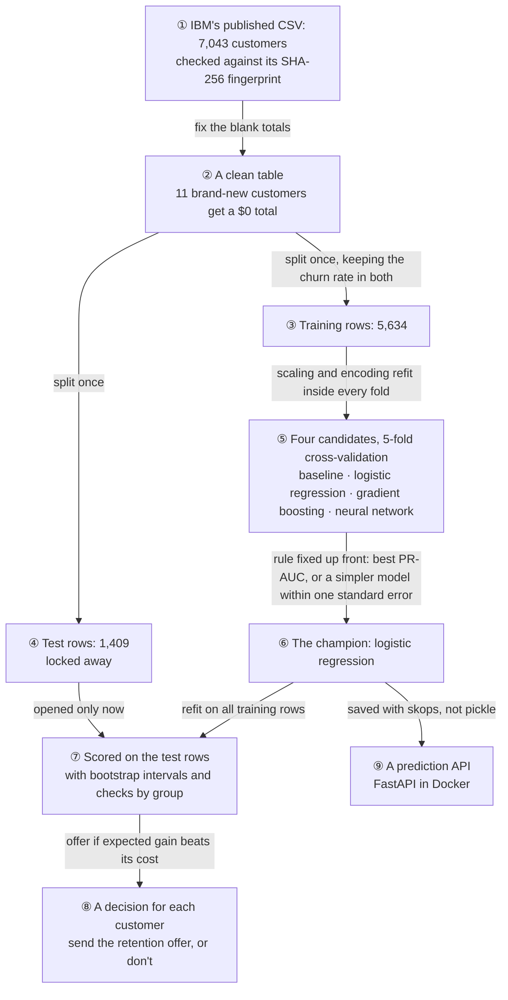
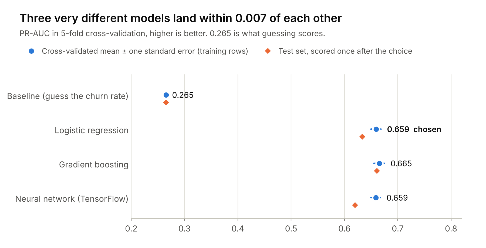
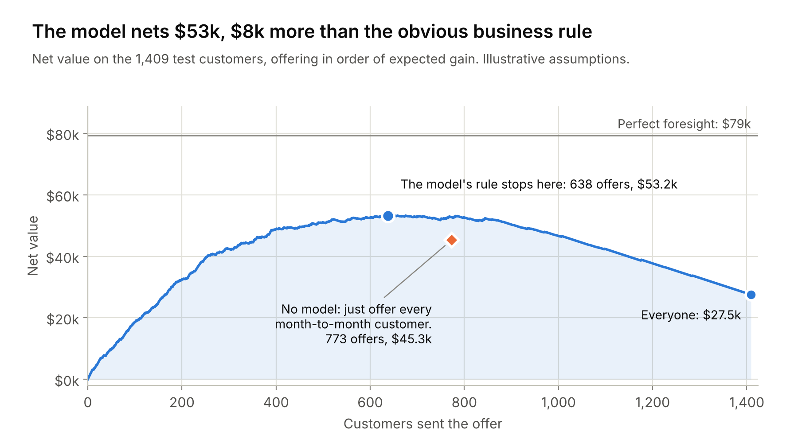
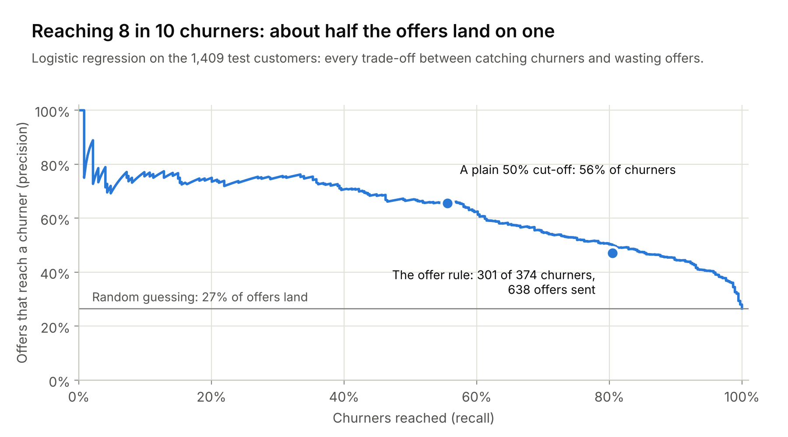
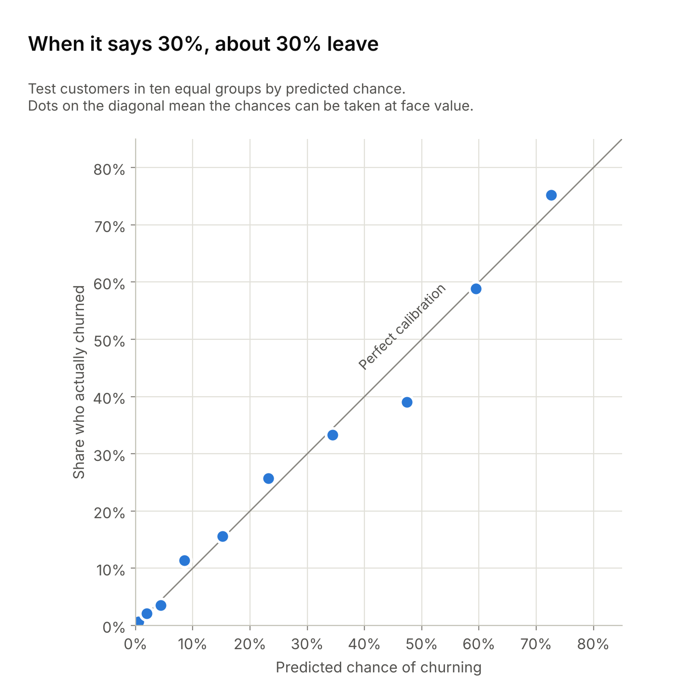
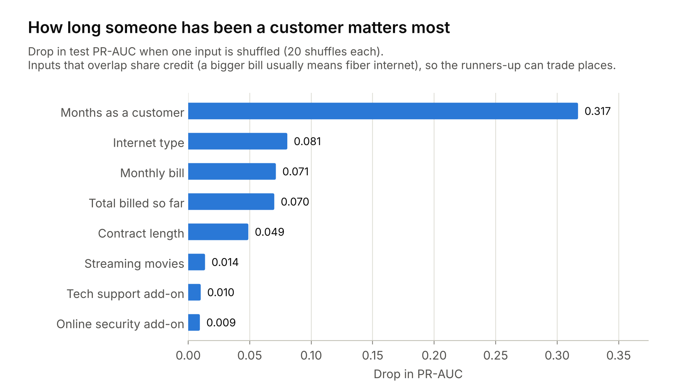

# 📉 Telco Customer Churn, rebuilt

**Which customers are about to leave, and is it worth reaching out before they do?**

[](https://github.com/OGobidike/Teleco-Customer-Churn/actions/workflows/ci.yml)


<picture>
  <source media="(prefers-color-scheme: dark)" srcset="docs/images/hero-dark.png">
  
</picture>

In January 2025 I trained a TensorFlow network on IBM's telecom dataset and reported **81% accuracy**.
Since then I've spent a year and a half at Outlier (Scale AI) reviewing AI-generated code and writing
prompts that test how models reason, and I've built a full data platform for my own app. So I came
back to this project with a reviewer's eyes.

I found five problems in my own notebook. Instead of quietly fixing them, I measured what each one
did to the score, then rebuilt the project the way I'd build it today: preprocessing that can only
learn from training rows, a model chosen
by a rule fixed in code before the first run, a test set opened only after that choice, a score
that turns into a business decision, and an API that serves it.

If you're learning machine learning, [the audit](#-the-audit-what-my-2025-notebook-got-wrong) is the
part to read. It shows, with numbers, what common mistakes do (and don't do) to a score.

## ✨ 2025 vs 2026 at a glance

| | 2025 notebook | 2026 rebuild |
|---|---|---|
| **The score I reported** | 81.05% accuracy, from one run with no TensorFlow seed | **PR-AUC 0.634** (95% interval 0.577–0.686) and **ROC-AUC 0.842** |
| **Accuracy, for comparison** | 81.05% | 80.5%. The model didn't get "more accurate". It got trustworthy and useful |
| **Compared with guessing** | Not mentioned. "Nobody churns" already scores 73.5% | Every model is shown beside a baseline that guesses the churn rate |
| **How well it ranks customers (ROC-AUC)** | 0.858 on its own split, 0.841 on average over 10 others (replayed) | 0.842. **No better.** The rebuild did not find a sharper model |
| **Churners reached at a 50% cut-off** | 53% (replayed over 10 seeds) | 56%. About the same |
| **Churners reached by the offer rule** | No rule | **80%** (301 of 374), by sending more offers: 47% of them land on a churner |
| **How the test set was used** | Watched every epoch during training | Opened only **after** the model was chosen |
| **Scaling and encoding** | Learned from all 7,043 rows before the split | Refit inside every training fold, so test rows can't shape them |
| **What to do with a prediction** | Nothing | Send an offer when the expected gain beats its cost: **$53.2k** net, **$8.0k** more than the obvious rule with no model |
| **Can someone else get the same numbers?** | No TensorFlow seed, a Colab file path, a last cell that can't run | Data pinned by fingerprint, dependencies locked, CI retrains the scikit-learn models and checks their test scores |
| **Tests** | None | **47**, including one that spies on every scaler fit during cross-validation |
| **Served** | No | FastAPI in Docker, model stored with skops instead of pickle |

<details>
<summary><b>The words used here, in plain terms</b></summary>

| Word | What it means |
|---|---|
| **Churn** | A customer leaving |
| **Test rows** | Customers set aside before any training, used only to score the finished model |
| **Leakage** | Information from the test rows slipping into training, which makes a score look better than it is |
| **PR-AUC** | Of the customers the model flags, how many really leave, averaged over every possible cut-off. Guessing scores 0.265 here; perfect is 1 |
| **ROC-AUC** | How well the model ranks leavers above stayers. Guessing scores 0.5; perfect is 1 |
| **Recall** ("churners reached") | Of the customers who really left, the share the model flagged |
| **Brier score** | How far the predicted chances are from what happened. Lower is better |
| **Cross-validation** | Training and scoring several times on different slices of the training rows, to see how much a score moves |
| **Standard error** | How much a score would wobble if the experiment were repeated |
| **Bootstrap interval** | A range for a score, made by re-drawing the test customers thousands of times |
| **Seed** | The number that fixes a program's "random" choices, so a run can be repeated exactly |
| **Epoch** | One pass of a neural network over its training rows |
| **SMOTE** | A method that invents extra examples of the rare group (here, churners) so a model pays them more attention |
| **Permutation importance** | Shuffle one input and see how much the score drops |

</details>

## 🔎 The audit: what my 2025 notebook got wrong

I kept [the original notebook](notebooks/2025-original/Teleco_Churn_Prediction.ipynb) exactly as it
was. [`audit.py`](src/churn/audit.py) replays it step for step, then fixes **one flaw at a time** and
retrains, over 10 seeds, so a real effect can be told apart from run-to-run noise. Each seed is a
fresh stratified split, and the runs share most of their rows, so read the intervals as a rough guide.

<picture>
  <source media="(prefers-color-scheme: dark)" srcset="docs/images/audit-dark.png">
  
</picture>

| What I did in 2025 | Why it's a problem | What fixing it changed (mean of 10 runs, rough 95% interval) |
|---|---|---|
| Learned the scaler and the gap-filling averages from all 7,043 rows, **before** splitting | Test rows shaped the training data (leakage) | Accuracy **+0.2** points (0.0 to +0.3): too small to tell from noise, and not in the direction of flattering my score |
| Filled 11 blank totals with the average (**$2,283**), and turned "No internet service" into 9,156 gaps filled with averages | The 11 blanks are brand-new customers whose true total is **$0**. Customers without internet became fractional subscribers | Accuracy **0.0** points (−0.2 to +0.2): no measurable change, though the data was wrong |
| Balanced the training rows with SMOTE, then trained on the **unbalanced** ones | The balancing never reached the model | Accuracy **−4.1** points, churners reached **+22.1** points (50% → 73%). It moved the cut-off, not the skill: ranking got slightly *worse* (ROC-AUC −0.8 points) |
| Passed the test set as `validation_data` | The test score was on screen at every epoch, so any choice made from it is tuned to the test set | It cost my 81.05% nothing I can show: I trained a fixed 20 epochs. Had I picked the stopping epoch from that screen (watching 60 epochs), the score would read **+0.6** points too high on average (+0.2 to +1.0 across the runs) |
| Reported accuracy only | With 73.5% of customers staying, accuracy rewards ignoring the churners | The only change that moved anything *lowered* accuracy while reaching far more churners, so accuracy was pointing the wrong way |

**What I take from it.** My 2025 number was real: replaying the notebook gives 81.1% on average
(80.6% to 81.8% across seeds), right around the 81.05% I reported. But it was one draw. On 10
other splits (stratified ones) the same notebook averages 79.6% (from 78.9% to 81.1%).

The leak and the bad gap-filling were real mistakes that happened not to flatter my score
here. That's luck, not safety. The same habit with a step that looks at the answer column, or with a
small dataset, can inflate a score badly, so in the rebuild preprocessing lives inside the model
pipeline, where it can only ever be fitted on training rows.

The real problem was the yardstick. Accuracy made the model that ignores churners look best. And
the honest headline of this rebuild is not a better model. It's the same skill, measured properly
and put to use.

## 🧪 How the rebuild works



Everything that *learns* from data (the scaler, the category encoder) lives inside one scikit-learn
`Pipeline` with the model, so cross-validation refits it on training rows only. Models with settings
to tune are tuned *inside* each fold (nested cross-validation), so tuning can't flatter the comparison.

## 📊 Choosing the model

<picture>
  <source media="(prefers-color-scheme: dark)" srcset="docs/images/models-dark.png">
  
</picture>

Before the first run, I fixed the rule in code: **the best mean cross-validated PR-AUC wins, unless
a simpler model is within one standard error of it.** In cross-validation gradient boosting scored highest (0.665), but logistic regression (0.659) was within one standard error of it (0.010), so the rule chose the simpler model.

That yardstick turned out to be blunt. Fold by fold, boosting was ahead in 5 of 5 (by 0.006 on
average), and on the test set, scored after the choice, it came out ahead by 0.028 PR-AUC (paired
bootstrap interval 0.006 to 0.050). A rule built on the fold-by-fold difference would have picked
boosting. I kept the rule's choice anyway: switching champions after looking at the test set is
exactly the habit the audit warns about. And in money terms the two are a wash under the assumptions below: boosting's offers would have netted $54.3k against $53.2k, a difference of +$1.0k whose interval (−$0.6k to +$2.8k) includes zero.

The neural network, rebuilt properly (it now stops early on a slice of the *training* rows, though
unlike the other two I did not tune it), matched
the logistic regression in cross-validation (both 0.659) and trailed it on the test set
(0.620 against 0.634). On a table of 7,000 customers that's normal, and worth knowing before
reaching for the bigger tool.

I picked **PR-AUC** (average precision) as the main score because it asks the question a retention
team cares about: among the customers the model flags, how many are really leaving?

## 💰 From a score to a decision

A churn score is only useful if it changes what someone does. The rule here is simple: **send a
retention offer when the customer's chance of leaving × what keeping them is worth is more than the
offer costs.**

| Assumption (illustrative, not the telecom's numbers) | Value |
|---|---|
| Cost of one offer (a one-time bill credit) | $50 |
| Share of would-be churners the offer keeps | 30% |
| A kept customer keeps paying | 12 more months of their monthly bill |

<picture>
  <source media="(prefers-color-scheme: dark)" srcset="docs/images/offer-value-dark.png">
  
</picture>

On the 1,409 test customers the rule sends **638 offers**, reaches **301 of the 374
churners**, and nets **$53.2k** (95% interval $45.2k to $61.5k). Offering everyone nets $27.5k, and
perfect foresight would net $79.3k.

The fairer test is a rule that needs **no model at all**: offer every month-to-month customer. That
sends 773 offers and nets $45.3k. So what the model really adds is the difference,
**$8.0k** on these customers (interval $4.7k to $11.5k), with fewer offers sent. Because the
model's rule uses each customer's own bill, a high-paying customer is worth an offer at a lower chance
of leaving than a low-paying one.

<picture>
  <source media="(prefers-color-scheme: dark)" srcset="docs/images/precision-recall-dark.png">
  
</picture>

A plain 50% cut-off would reach only 56% of churners. The SMOTE step in my 2025 notebook was
an attempt to fix that. A decision rule built on honest probabilities does it without inventing rows.

## 🎯 Can the percentages be trusted?

<picture>
  <source media="(prefers-color-scheme: dark)" srcset="docs/images/calibration-dark.png">
  
</picture>

The offer rule multiplies the predicted chance by money, so the chance has to mean what it says.
Grouping the test customers into ten bands, the predicted and actual churn rates line up closely.
The biggest miss is the band predicted at 47%, where 39% left (Brier score 0.138; the
baseline scores 0.195). That's one reason a logistic regression
suits this job.

## ⚖️ Does it work as well for everyone?

The model never sees gender. Measured on the training rows, adding it changed PR-AUC by −0.0002
(fold-to-fold spread 0.0014), which is nothing, and who gets an offer shouldn't depend on it. I
still check the results by gender and by other groups.

| Group | Customers | Churn rate | Ranking (ROC-AUC) | Churners reached | Sent an offer |
|---|---:|---:|---:|---:|---:|
| Gender: Female | 687 | 28% | 0.838 | 79% | 46% |
| Gender: Male | 722 | 25% | 0.847 | 82% | 45% |
| Senior citizen: No | 1,187 | 23% | 0.843 | 76% | 40% |
| Senior citizen: Yes | 222 | 44% | 0.784 | 94% | 76% |
| Has a partner: No | 736 | 34% | 0.815 | 81% | 54% |
| Has a partner: Yes | 673 | 19% | 0.856 | 79% | 36% |
| Has dependents: No | 978 | 31% | 0.827 | 84% | 54% |
| Has dependents: Yes | 431 | 16% | 0.855 | 66% | 25% |
| Contract: Month-to-month | 773 | 43% | 0.744 | 85% | 71% |
| Contract: One year | 300 | 12% | 0.741 | 58% | 28% |
| Contract: Two year | 336 | 3% | too few churners | 0 of 9 | 1% |
| Months as a customer: 0–12 | 449 | 48% | 0.747 | 82% | 67% |
| Months as a customer: 13–24 | 206 | 29% | 0.814 | 92% | 62% |
| Months as a customer: 25–48 | 304 | 21% | 0.800 | 73% | 42% |
| Months as a customer: 49–72 | 450 | 8% | 0.833 | 63% | 18% |

- **Women and men** get offers at the same rate (46% and 45%), and the model
  reaches 79% and 82% of their churners. The difference in how well it ranks them
  (−0.052 to +0.034 ROC-AUC, 95% interval) is no bigger than noise.
- **Senior citizens** churn far more (44% against 23%), so 76% of them
  get an offer. The model ranks them less sharply (0.784 against 0.843), but with only
  98 senior churners in the test rows the gap isn't settled (−0.122 to +0.004). It's the
  first thing I'd watch in production.
- **Customers with dependents** show the widest gap in reach: 66% of their churners get an offer
  against 84% for the rest. They churn half as often, so fewer clear the rule's bar.
- **Within one contract type** the ranking drops (0.744 for month-to-month), because contract length
  itself carries much of the signal.
- **Age stays an input, and I'm not sure it should.** Senior-citizen status is in the model although
  the model barely leans on it. Dropping it by the same test I used for gender is the next experiment.

## 🧭 What the model leans on

<picture>
  <source media="(prefers-color-scheme: dark)" srcset="docs/images/drivers-dark.png">
  
</picture>

Months as a customer is clearly first, though part of its lead is an artifact: shuffling it also
scrambles a feature built from it (average monthly spend). The runners-up (internet type, the bills, contract length)
overlap with each other, so their order shifts with small modeling choices. These are associations
the model uses, not causes: "month-to-month customers leave more" doesn't show that changing anyone's
contract would keep them.

## 🚀 Run it yourself

You need [uv](https://docs.astral.sh/uv/). The dataset downloads itself on first run and is checked
against its fingerprint.

```bash
git clone https://github.com/OGobidike/Teleco-Customer-Churn.git
cd Teleco-Customer-Churn
uv sync --extra serve --extra figures   # light install, no TensorFlow (about 370 MB)
uv run churn check                      # retrain from the pinned data, confirm the committed scores (about 2½ minutes on 4 cores)
uv run pytest -m "not nn"               # the test suite
```

`churn check` retrains the three scikit-learn models in a temporary folder and fails if their
PR-AUC, ROC-AUC or Brier score on the test rows has moved by more than 0.005, or if a different model
wins. CI runs the same three steps on every pull request and every push to `main`. The neural
network and the audit are reproduced by hand, with the second block below.

For the neural network and the audit, add TensorFlow (about 2 GB installed):

```bash
uv sync --all-extras
uv run churn train           # all four models (about 3½ minutes)
uv run churn audit           # replay the 2025 notebook and measure each flaw (about 12 minutes)
uv run churn figures         # redraw every chart, light and dark
```

## 🔌 The API

```bash
docker build -t telco-churn .      # trains the champion inside the build
docker run --rm -p 8000:8000 telco-churn
```

Open `http://localhost:8000/docs` to try it in the browser, or:

```bash
curl -s localhost:8000/predict -H 'content-type: application/json' -d '[{
  "SeniorCitizen": "No", "Partner": "Yes", "Dependents": "No", "tenure": 2,
  "PhoneService": "Yes", "MultipleLines": "No", "InternetService": "Fiber optic",
  "OnlineSecurity": "No", "OnlineBackup": "No", "DeviceProtection": "No", "TechSupport": "No",
  "StreamingTV": "Yes", "StreamingMovies": "Yes", "Contract": "Month-to-month",
  "PaperlessBilling": "Yes", "PaymentMethod": "Electronic check",
  "MonthlyCharges": 95.5, "TotalCharges": 190.0}]'
```

```json
{
  "model": "logistic",
  "version": "2.0.0",
  "predictions": [
    {"churn_probability": 0.7669, "send_offer": true, "expected_gain": 263.67}
  ]
}
```

A request that describes an impossible customer (internet add-ons with no internet, say) gets a
`422` instead of a guess.

No Docker? `uv run churn train --no-nn` saves the champion to `models/`, and
`uv run uvicorn churn.api:app` serves it.

## ✅ Tested

- ✅ **All 47 tests pass**: data cleaning, the pipeline, the choosing rule, the offer math, the API, the replay of my 2025 notebook, and this README's headline numbers. CI runs the 46 that don't need TensorFlow.
- ✅ **Leakage has a test.** It spies on every scaler fit made during nested cross-validation and fails if one ever sees rows from outside its training fold.
- ✅ **The results reproduce.** In a clean copy, retraining all four models, re-running the whole audit and redrawing every chart gave back the committed files byte for byte. The model trained inside the Docker build lands on the same scores.
- ✅ **A clean copy works.** Every command under "Run it yourself" ran in an empty folder with no virtual environment, no data and no saved model.
- ✅ **The container works.** It builds, starts and passes its own health check. `/predict` answered the example above, an impossible customer got a `422`, and it runs as a non-root user on about 136 MB of memory.
- ✅ **The 2025 notebook is untouched**, and a test pins its fingerprint.
- ✅ **Every chart** is drawn in a light and a dark version and checked by eye, in a palette chosen for color-blind safety.
- ✅ **Lint clean** (ruff).

## 📁 What's in the repo

| Path | What it is |
|---|---|
| ✨ [`src/churn/data.py`](src/churn/data.py) | Downloads the dataset, checks its fingerprint, fixes the blank totals |
| ✨ [`src/churn/features.py`](src/churn/features.py) | Feature preparation that can only learn from training rows |
| ✨ [`src/churn/models.py`](src/churn/models.py) | The four candidates, including the rebuilt TensorFlow network |
| ✨ [`src/churn/train.py`](src/churn/train.py) | Nested cross-validation, the choosing rule, the one-time test score |
| ✨ [`src/churn/evaluate.py`](src/churn/evaluate.py) | Scores, bootstrap intervals, the offer rule, the checks by group |
| ✨ [`src/churn/audit.py`](src/churn/audit.py) | The replay of my 2025 notebook and its experiments |
| ✨ [`src/churn/api.py`](src/churn/api.py), [`serving.py`](src/churn/serving.py), [`Dockerfile`](Dockerfile) | The FastAPI app, safe model loading, and its container |
| ✨ [`src/churn/figures.py`](src/churn/figures.py), [`cli.py`](src/churn/cli.py) | Every chart in this README, and the `churn` command |
| ✨ [`results/`](results) | Every number in this README, as committed JSON and CSV |
| ✨ [`MODEL_CARD.md`](MODEL_CARD.md) | What the model is for, what it isn't for, and how it does for each group |
| ✨ [`tests/`](tests) | 47 tests |
| [`notebooks/2025-original/`](notebooks/2025-original) | My 2025 notebook, unchanged |

## ⚠️ Limits

- **One snapshot, no dates.** The data has no time column, so the model has never been tested on
  *future* customers. A real deployment would train on past months and test on the next one.
- **The offer numbers are assumptions.** Change them in [`evaluate.py`](src/churn/evaluate.py) and the
  decisions change with them.
- **Small groups are hard to judge.** Only 9 customers with two-year contracts churned
  in the test set, too few to score the model on that group.
- **Associations, not causes.** See [what the model leans on](#-what-the-model-leans-on).
- **Two looks at the test rows, not one.** I ran the whole procedure, then dropped gender from the
  inputs (a decision made on training rows) and ran it again. Both runs scored the test rows at the
  end, and each run scores all four candidates there, though none is chosen from it.
- **The offer numbers were not stress-tested.** A different offer cost or save rate moves every dollar
  figure here.

## 🙏 Credits

Data: [IBM Telco Customer Churn](https://github.com/IBM/telco-customer-churn-on-icp4d) (Apache-2.0).

I build with an AI pair-programmer (Claude Code), and I review, test and run every change myself.

More of my work: [llm-code-eval](https://github.com/OGobidike/llm-code-eval), an evaluation of two AI
models' Python answers with hidden tests and blind grading, and
[Morning Manna](https://github.com/OGobidike/Morning-Manna), a Bible-reading app built as a full data
platform.

Code: MIT, © 2025–2026 Francis (Oguguamakwa) Obidike.
